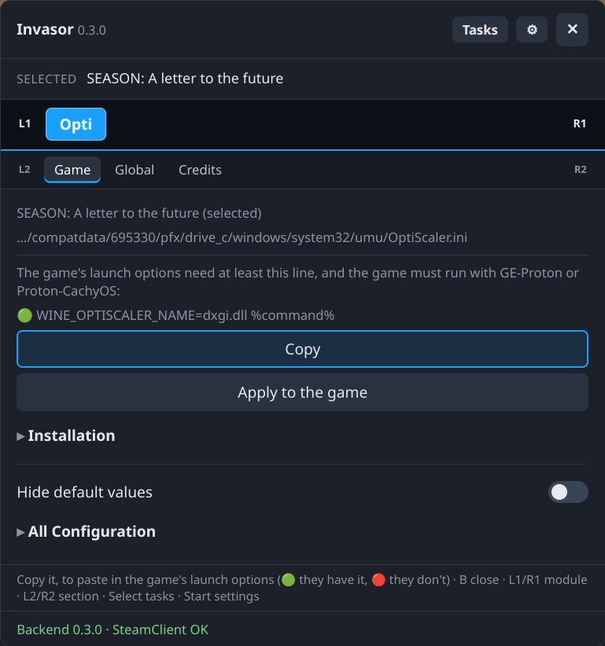
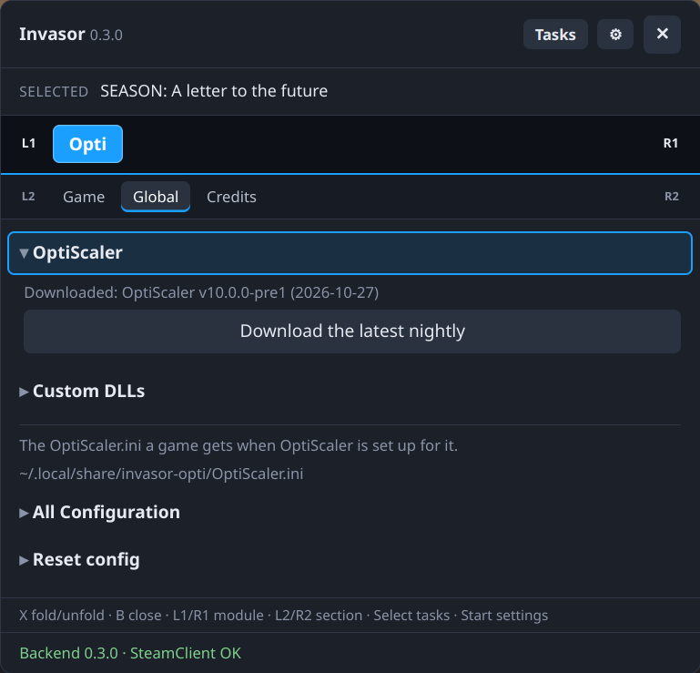

# OptiScaler

An [Invasor](https://github.com/Gamemode-Invasor/invasor) module for [OptiScaler](https://github.com/optiscaler/OptiScaler) from the panel: it downloads the latest nightly, installs it in the selected game (with your FSR 4 driver DLLs or HelixSR if you want), and edits any `OptiScaler.ini`. It lives in the library's Invasor panel only, not in Quick Access: there's nothing to do with it during a game. Three sub-tabs (L2/R2):

- **Game**: OptiScaler in the selected game, and its file.
- **Global**: the module's own file, the one a game gets when OptiScaler is set up for it. It is kept in `~/.local/share/invasor-opti/OptiScaler.ini` (removed when the module is uninstalled with its data) and starts as a copy of `opti/assets/OptiScaler.invasor.ini`. Two buttons under it, in a folded **Reset config** group, replace it after asking: **Reset to OptiScaler defaults** (`opti/assets/OptiScaler.optiscaler.ini`, the file as OptiScaler v10.0.0-pre1, nightly 2026-10-23, ships it, GPL-3.0) and **Reset to invasor-opti defaults** (the file it started as).

  Above it, the **OptiScaler** group shows the OptiScaler build the module has downloaded, and **Download the latest nightly** gets the newest build of [OptiScaler-nightly](https://github.com/optiscaler/OptiScaler-nightly/releases) (it shows in the Tasks panel). The `.7z` is checked against GitHub's checksum and unpacked as it is into `~/.local/share/invasor-opti/optiscaler/`, with `.invasor-opti.version` saying which build it is; the old build is replaced only once the new one is complete, and a build with a symbolic link in it is refused. Unpacking needs `bsdtar` (part of SteamOS).

  Under it, **Custom DLLs** keeps the DLLs the module can't ship, chosen in Invasor's file picker (a big window that lists folders and `.dll` files; a `.dll` is picked by pressing it), with the version each file says it is:
  - **FSR 4 (AMD driver DLLs)**: `amdxcffx64.dll` from AMD's driver, and `amdvkffx64.dll` if it's next to it (INT8 RDNA2 and INT8 Lite need it).
  - **HelixSR**: its DLL (kept as `helixsr.dll`), and `helixsr.ini` if it's next to it. Or **Download and compile**, after asking: `opti/bin/helixsr-fetch.sh` downloads the latest stable release of [HelixSR](https://github.com/lonewolf0622/HelixSR) and builds it on this device with HelixSR's own setup (which downloads NVIDIA's DLSS DLL, under NVIDIA's license, and uses it once), in a temporary folder and with its games step turned off, so nothing is installed in any game; the `helixsr.dll` and `helixsr.ini` it makes are kept here like a chosen DLL. It runs as a task in the Tasks panel (it can take a few minutes, not while a game is running) and needs `curl` and `unzip`, plus a Proton (or Wine) in Steam, which HelixSR's setup uses for its shader compiler (and Python 3 with numpy, or it downloads a portable one). The DLL carries NVIDIA's network: it's for your own device, don't share it. The module asks GitHub for the latest stable tag (at most once an hour once it has an answer; a failed check is retried after 2 minutes) and compares it with the version the kept `helixsr.dll` says it is: the button then reads **Update to v…** when there's a newer one, or **Recompile** when it's up to date.

  The module keeps a copy in `~/.local/share/invasor-opti/custom/`, so the original can move or be on a card that isn't there. **Remove** forgets it; games that have it keep theirs.
- **Credits**: author, thanks to OptiScaler and HelixSR, and that this module isn't affiliated with either.

The game's file is read from its Proton prefix, `compatdata/<appid>/pfx/drive_c/windows/system32/umu/OptiScaler.ini`, the folder Wine's OptiScaler hack in GE-Proton and proton-cachyos loads OptiScaler from (with `WINE_OPTISCALER_NAME=dxgi.dll %command%` in the game's launch options).

Under the file's path, the Game tab installs OptiScaler in that folder:

- When OptiScaler is installed (there is an `OptiScaler.dll`, whoever put it there), the launch line, `WINE_OPTISCALER_NAME=dxgi.dll %command%`, with a **Copy** button, after 🟢 when the game's launch options have it (whatever else is around it) or 🔴 when they don't. The options are asked to Steam; when Steam can't answer they're read from its files, and a Steam game's (`localconfig.vdf`, which Steam writes only from time to time) may lag. When Steam can change them, **Apply to the game** writes the line into the game's launch options: it adds `WINE_OPTISCALER_NAME=<dll>.dll` (or replaces the one there), adds `%command%` if it's missing (what was there before are the game's arguments, so they go after it), and keeps the rest; Steam shows a notification. Copy stays for a Steam without that call. The game's launch options need at least that line, and the game must run with GE-Proton or Proton-CachyOS (the two with Wine's OptiScaler hack).
- A folded **Installation** group:
  - **Install OptiScaler** copies the build downloaded in Global: `OptiScaler.dll`, the `OptiScaler` folder and `.invasor-opti.version`, plus the Global `OptiScaler.ini` if the game has none (an existing one is kept). Then it links the chosen DLL name to `OptiScaler.dll`.
  - **Update to OptiScaler …** shows when Global has downloaded another build than the game's (or the game's was put there by hand): it copies the build's files over the game's (`OptiScaler.dll`, every file of the `OptiScaler` folder, `.invasor-opti.version`). Everything else stays: the game's `OptiScaler.ini`, its DLL name, its custom DLLs and anything you added to the folder. A DLL name that was a copy of `OptiScaler.dll` becomes a link to it.
  - **Uninstall OptiScaler** (after asking) removes `OptiScaler.dll`, `OptiScaler.ini`, the `OptiScaler` folder, `.invasor-opti.version`, and every `dxgi.dll`, `d3d12.dll`, `dbghelp.dll` or `winmm.dll` that is a link to `OptiScaler.dll` or a copy of it. The `OptiScaler` folder goes whole, with anything you added there (your `helixsr.ini`, plugins…); nothing else in `umu` is touched.
  - **DLL to load** (`dxgi`, `d3d12`, `dbghelp`, `winmm`): the name the game loads OptiScaler as. Changing it while OptiScaler is installed renames the link and changes the launch line. A DLL of that name that isn't OptiScaler is never replaced.
  - With OptiScaler installed, a switch per custom DLL (enabled once it's chosen in Global): **FSR 4 driver DLLs** copies them into the game's `OptiScaler` folder; **HelixSR** copies `helixsr.dll` there (and `helixsr.ini` if the game has none) and sets `[Libraries] FfxDx12SRPath=C:\windows\system32\umu\OptiScaler\helixsr.dll`, so HelixSR is one more FidelityFX upscaler next to FSR 4 and the older ones. Turning it off removes them (and `helixsr.log`) and puts `FfxDx12SRPath` back to `auto` if it pointed to HelixSR.

Each page is built from the file itself, so it follows whatever OptiScaler version is installed:

- Everything sits in one **All Configuration** group, folded, and inside it one group per `[Section]`, folded too. **X** folds or unfolds the group the cursor is in.
- One option per key, with its current value. When the comments above the key name its values (`true or false`, `0 = FSR 4.0.2 | 1 = FSR 3.1.5`, `0.0 - 1.0`, `xess, fsr21, ffx, dlss`) it is a list, with `auto` (OptiScaler's own default) first; otherwise it is a text field, where empty means `auto`.
- In the Game tab, **Hide default values** (just above it) hides the options whose value is still OptiScaler's own (from the build downloaded in Global, else the file in `opti/assets/`), and the groups left empty: what's left is what was changed.
- **Y** shows the key's description, the comments OptiScaler wrote above it.
- Every change is written at once (a list once its value stays put for a moment, so going through it with ←→ doesn't write each value on the way). Only the line of that key changes: comments, order and line ends stay as they are. If another program changed the file meanwhile, nothing is written and the page reloads.

## Screenshots

<p align="center">
  
  
</p>

## Requirements
Invasor 0.3.0 or newer (`min_core`): it uses `ctx.http` to ask GitHub and download the nightly, `ctx.archive` to unpack it and swap folders, `ctx.paths` and `ctx.vdf` to find a game's prefix and read Steam's files, `ctx.steam` for the launch options, and `ctx.copy` and `ctx.pickPath` in the panel. `bsdtar` (part of SteamOS) unpacks the `.7z`.

## Build, test and install
With the core checked out next to this repository (`../invasor`):

```sh
python3 ../invasor/tools/pack_module.py opti       # build, check, tests -> opti-<version>.zip
python3 ../invasor/tools/install_module.py opti    # or install that zip from ⚙ Settings › Install module
```

## Changes

### 0.2.0
- Needs Invasor 0.3.0: the nightly is downloaded, checked and unpacked by the core (`ctx.http`, `ctx.archive`), Steam's folders and files come from `ctx.paths` and `ctx.vdf`, and the panel uses the core's file picker and clipboard. 7-Zip is no longer used: `bsdtar` (part of SteamOS) unpacks the `.7z`.
- Game: **Apply to the game** writes the launch line into the game's launch options (when Steam can), keeping the rest of the line; the 🟢/🔴 mark asks Steam first, so it no longer lags for Steam games.
- README: screenshots.

### 0.1.1
- Global → Custom DLLs: **Download and compile** builds the latest stable HelixSR on this device and keeps its `helixsr.dll` and `helixsr.ini` (it replaces HelixSR in the Companion module). The button tells when a newer stable HelixSR is out (**Update to v…**) or yours is the latest (**Recompile**).

### 0.1.0
- First release.

## License
[GNU General Public License v3.0 or later](LICENSE) (GPL-3.0-or-later).

### Third-party
- `opti/assets/OptiScaler.optiscaler.ini` is OptiScaler's own file, and `opti/assets/OptiScaler.invasor.ini` is made from it: [OptiScaler](https://github.com/optiscaler/OptiScaler) is GPL-3.0.
- No DLL is shipped with the module. OptiScaler is downloaded from its own nightly releases, which carry the licenses of what they include (FidelityFX, XeSS, DirectX) in their `Licenses` folder. AMD's driver DLLs and HelixSR are files you bring, or HelixSR is built on your machine with **Download and compile**: they're copied only on your machine. To build HelixSR, its own setup downloads NVIDIA's DLSS DLL ([NVIDIA's license](https://github.com/NVIDIA/DLSS/blob/v310.7.0/LICENSE.txt)) and uses it once; the DLL it makes carries NVIDIA's network and is for your own device only.
- This module isn't affiliated with OptiScaler, HelixSR or AMD.
